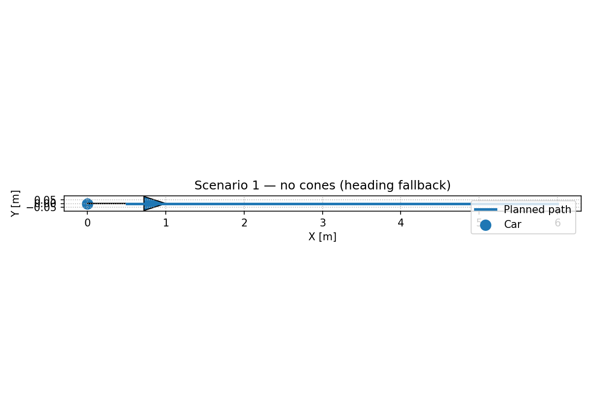
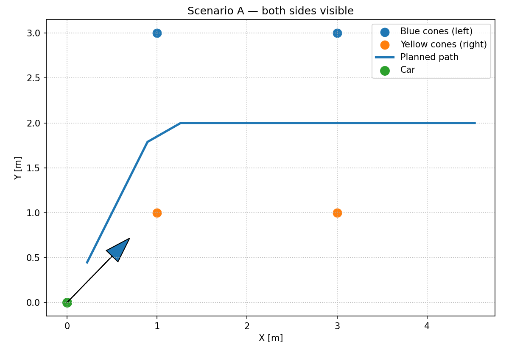
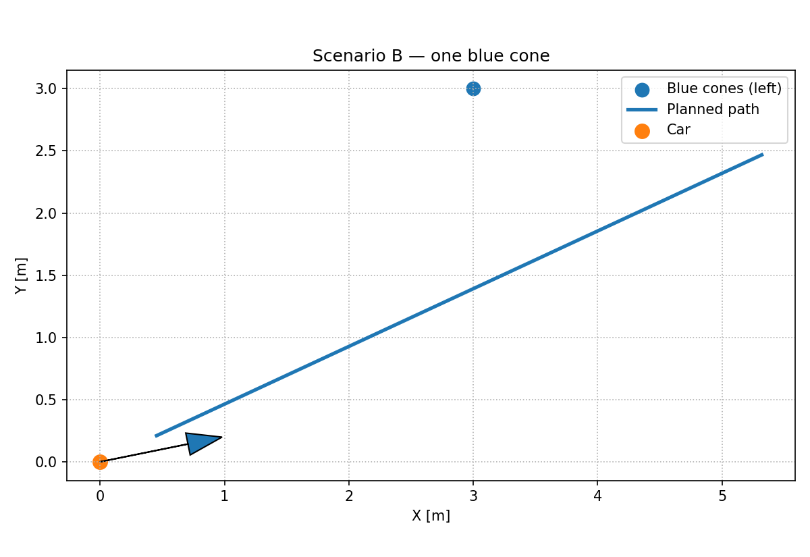
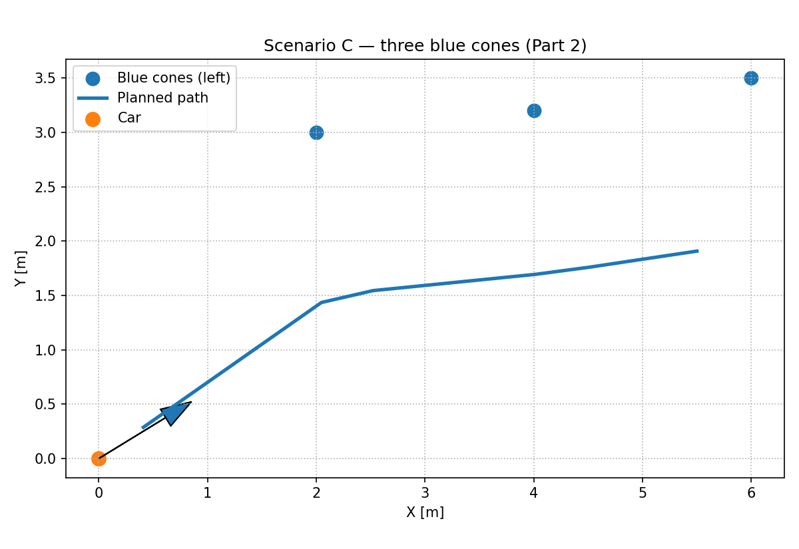
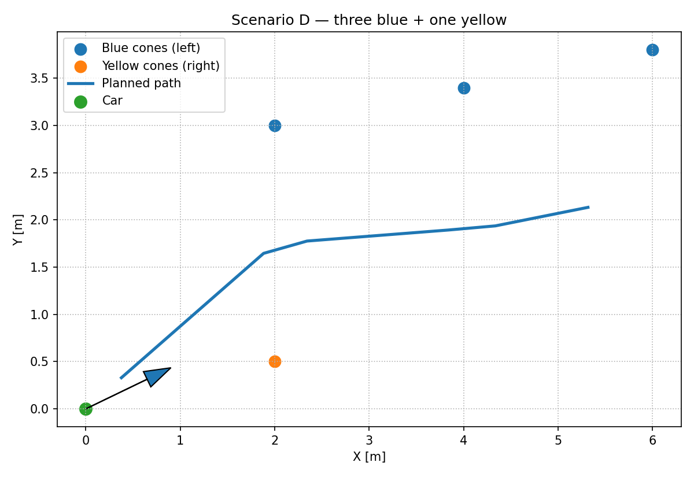
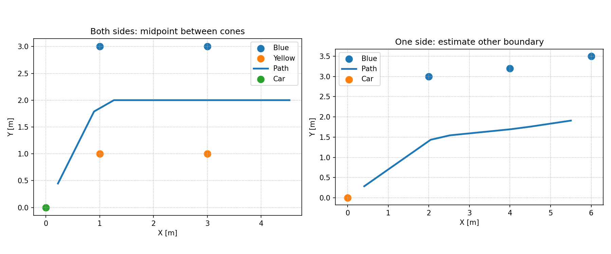
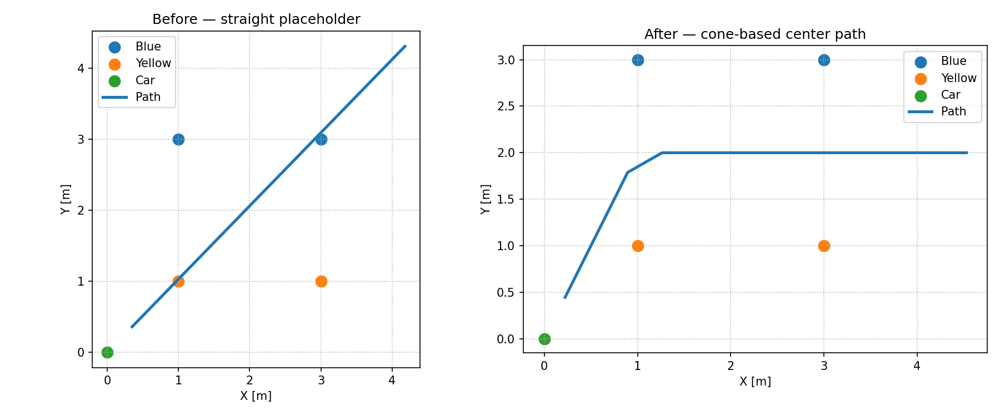

# ARL Path Planning Task — Simple Cone-Based Planner

This is my solution for the Path Planning assignment.

I tried to keep the implementation at the level of a student working on a Racing Team task. The goal here was not to build a production autonomous-driving planner. I wanted something that is simple enough to understand and explain, but still handles the main cases in the assignment.

## 1. What the task gives us

For each scenario we get:

- the car pose `(x, y, yaw)`
- blue cones (`color == 1`) on the left side
- yellow cones (`color == 0`) on the right side

The planner has to return a path in world coordinates.

The assignment also asks us to think about the harder case where we have **three cones on only one side**.

---

## 2. My basic idea

I used a simple center-line approach.

### Case A — both sides are visible

When I have a blue cone and a yellow cone that belong to the same part of the track, I take their midpoint.

```text
Blue
  ●

  ↓ midpoint

  ●  ← planned center

  ↑ midpoint

  ●
Yellow
```

In code, the idea is simply:

```python
center = (blue + yellow) / 2
```

This gives us a point near the middle of the track.

---

### Case B — only one side is visible

If I only have one side, I cannot calculate the midpoint directly.

So I make one simple assumption:

> The track is approximately 3 meters wide.

I estimate the local direction of the cones, calculate a perpendicular direction (a normal), shift the detected cone by the track width to estimate the other boundary, and then take the midpoint.

```text
Detected side
     ●
     |
     |  estimated track width
     |
     ●  estimated other side

     ↓ midpoint

     ●  center path
```

The important part is that I use the **color** to choose which side of the cone is the center:

- blue = left boundary → center is to the right
- yellow = right boundary → center is to the left

This is intentionally a simple geometric estimate.

---

### Case C — no cones

If no cones are available, there is not enough information to estimate the track.

So I use the car's current heading and generate a short straight path.

This is not trying to guess the track. It is just a safe/simple fallback for the information available in this task.

---

## 3. What happens inside `generatePath()`

The flow is:

```text
             Detected cones
                    |
                    v
          Split blue / yellow
                    |
                    v
        Estimate center points
                    |
          +---------+---------+
          |                   |
     Both sides          One side only
          |                   |
       midpoint        normal + width
          |                   |
          +---------+---------+
                    |
                    v
             Order points
                    |
                    v
          Add car as start
                    |
                    v
        Interpolate every 0.5 m
                    |
                    v
             Planned path
```

I kept the whole main logic inside `generatePath()` because the original task asks students to implement that function.

---

## 4. Why I did not use A*, Dijkstra, MPC, splines, etc.

I considered the problem that was actually given rather than trying to make it look more advanced than it is.

There is no occupancy grid, no map, no large search space, and no obstacle cost map in this assignment.

For this simplified FSAI-style problem, a center-line construction is enough to demonstrate the main idea.

The assignment itself also says to keep the solution simple.

In a real race car, this would only be one small part of the complete planning stack.

---

## 5. Path generation

The final path uses a step of:

```text
0.5 m
```

and looks up to:

```text
6 m
```

ahead.

If the detected cones do not provide enough points to reach 6 m, the planner continues from the last known direction.

This keeps the returned path long enough for the tester and keeps the spacing simple.

---

# 6. Scenarios

I kept all of the original scenarios `1` to `20`.

I also added four extra scenarios for Part 2:

| Scenario | What it tests |
|---|---|
| 21 | Three blue cones only |
| 22 | Three yellow cones only |
| 23 | Three blue + one yellow |
| 24 | One blue + three yellow |

The extra scenarios are in:

```text
src/scenarios.py
```

### Scenario 1 — no cones



With no cones, the planner uses the car heading as a simple fallback.

### Scenario 3 — both sides visible



Here the planner can directly use the midpoint between blue and yellow cones.

### Scenario 9 — only one cone



With one cone, the planner has to make an estimate instead of calculating a true midpoint.

### Scenario 21 — three cones on one side



This is the main Part 2 case. Instead of using only the first cone, the planner uses the local direction of the three cones to estimate the center line.

### Scenario 23 — three blue + one yellow



This checks that the planner can use a real midpoint where both sides are available and the one-sided estimate where they are not.

---

# 7. Comparison

The two main ideas can be compared like this:



When both sides are available, the midpoint is the most direct information we have.

When only one side is available, the center is an estimate based on:

```text
cone position
+
local direction
+
assumed track width
```

I think this is a good trade-off for this assignment because the implementation stays small and the assumption is easy to explain.

---

# 8. Before vs after

The original project contains a straight-line placeholder.



The placeholder only follows the car heading.

The implemented version actually uses the detected cones to change the path.

---

# 9. Main assumptions

I made a few assumptions because the assignment allows us to do that.

### Track width

I assumed:

```python
track_width = 3.0
```

This is only an estimate for the simplified task.

### Cone ordering

The cones on each side are sorted by distance from the car.

With the small number of cones in this assignment, this is a simple way to get a near-to-far order.

### One-sided cones

For a one-sided case, I assume the local direction of the visible boundary is a reasonable approximation of the track direction.

### No cones

If there are no cones, the car heading is used as a fallback.

---

# 10. Limitations

This solution is intentionally not a full race-car planner.

Some limitations are:

- A fixed 3 m track width will not work for every real track.
- Sorting by distance is not a complete cone association algorithm.
- The one-sided case is only an estimate.
- There is no explicit collision checking.
- There is no curvature or vehicle-dynamics constraint.
- There is no speed planning.
- The path is piecewise linear, not a full smooth vehicle trajectory.
- The planner only uses the local information supplied by the assignment.

These are things I would look at if the problem became more realistic.

---

# 11. What I would improve next

If I had more time and the problem allowed more complexity, I would improve it step by step instead of changing everything at once.

### First

Improve cone association:

- match cones using distance and local geometry
- avoid incorrect pairing on curves

### Second

Estimate the track width from reliable pairs instead of always using 3 m.

### Third

Add a simple smoothing method so sharp changes between center points are reduced.

### Fourth

Add basic checks for:

- path going outside the track
- unrealistic jumps
- very sharp turns

After that, more advanced planning methods could make sense depending on the actual racing stack.

---

# 12. How to run

From the project root:

```bash
pip install -r requirements.txt
```

Then run a scenario:

```bash
python -m src.run --scenario 3
```

For the Part 2 cases:

```bash
python -m src.run --scenario 21
python -m src.run --scenario 22
python -m src.run --scenario 23
python -m src.run --scenario 24
```

The tester opens a Matplotlib window showing:

- the car
- car heading
- blue cones
- yellow cones
- generated path

---

# 13. Project structure

```text
Path Planning Task/
│
├── Documentation.md
├── requirements.txt
│
├── docs/
│   └── figures/
│       ├── comparison.png
│       ├── placeholder_vs_solution.png
│       ├── scenario_both_sides.png
│       ├── scenario_one_cone.png
│       ├── scenario_three_one_side.png
│       └── scenario_mixed_three_one_side.png
│
└── src/
    ├── __init__.py
    ├── models.py
    ├── path_planning.py
    ├── run.py
    ├── scenarios.py
    └── tester.py
```

---

## Final note

I tried to keep this solution at a level where I can explain the reasoning behind every important part of it.

The main idea is not complicated:

**use the cones when we have them, estimate the missing side when necessary, find the center of the track, and turn those center points into a simple path.**

That felt like the right level for this task instead of adding a complicated algorithm just to make the code look advanced.
## AI Usage

AI tools were used to help write and organize this Documentation file and for some small coding assistance during the implementation. 
